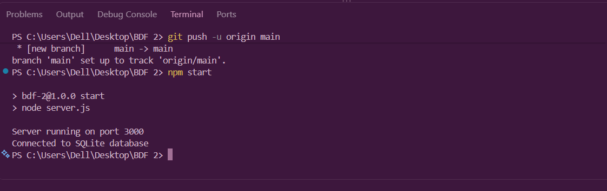

# LAB 2: Node.js and SQLite Database

## 1. Introduction

This laboratory experiment focuses on integrating an SQLite database with Node.js and Express.js. The main purpose is to understand how a server-side application connects to a database and performs database operations through API endpoints.

SQLite is a lightweight relational database that allows data to be stored and managed efficiently. In this experiment, Node.js and Express.js are used to create a server, while SQLite is used for database connectivity and data management.

## 2. Objectives

- To understand the fundamentals of Node.js and Express.js.
- To learn how to connect an SQLite database with a Node.js application.
- To create and manage database connections.
- To perform database operations using SQL queries.
- To create API endpoints for handling requests and responses.
- To test the application using a web browser or API testing tools.

## 3. Software and Technologies Used

- Visual Studio Code
- Node.js
- Express.js
- SQLite
- sqlite3
- JavaScript
- Git and GitHub
- Render (for deployment)

## 4. Project Structure

```text
BDF 2/
│
├── node_modules/
├── screenshots/
│   ├── server-running.png
│   ├── database-connection.png
│   ├── endpoint-response.png
│   └── other-screenshots.png
│
├── .gitignore
├── database.js
├── server.js
├── package-lock.json
└── package.json
```

## 5. Installation and Setup

### Step 1: Initialize the project

```bash
npm init -y
```

### Step 2: Install required dependencies

```bash
npm install express sqlite3 sqlite
```

### Step 3: Install Nodemon

```bash
npm install --save-dev nodemon
```

### Step 4: Start the application

```bash
npm start
```

The server runs on port 3000.

## 6. Database Description

SQLite is used as the database management system for this project.

The database connection is configured in `database.js` using the sqlite3 package.

The database is used to store and retrieve information through SQL queries.

## 7. Implementation

The project consists of two main JavaScript files:

### database.js

This file establishes the connection between the Node.js application and the SQLite database.

### server.js

This file creates the Express server, defines API routes, handles HTTP requests, and sends appropriate responses.

## 8. API Endpoints

The application provides API endpoints to interact with the server and database.

Add the actual endpoints implemented in the project:

| HTTP Method | Endpoint | Description |
|---|---|---|
| GET | / | Home route |
| GET | /your-endpoint | Add actual endpoint |
| POST | /your-endpoint | Add actual endpoint |

## 9. Output Screenshots

The following screenshots demonstrate the execution and output of the experiment.

### 9.1 Server Running Successfully



### 9.2 Database Connection


### 9.3 API Endpoint Response


### 9.4 Additional Output


## 10. Result

The Node.js application was successfully configured with an SQLite database using Express.js. The server was executed, and the database connection and API functionality were tested.

## 11. Conclusion

Through this laboratory experiment, I learned how to integrate an SQLite database with Node.js and Express.js. I gained practical experience in establishing database connections, understanding SQL-based data management, creating API endpoints, and handling HTTP requests and responses.

This experiment helped me understand the importance of database integration in backend web development and provided practical knowledge of building server-side applications.

## 12. GitHub Repository

Repository: Add your GitHub repository URL here.

## 13. Deployment Link

Public Deployment URL: To be added after successful deployment.